# Perfil dos clientes de alto gasto: uma análise exploratória do dataset *Customer Personality Analysis*

**Trabalho acadêmico de Ciência de Dados** — análise exploratória de dados, estatística descritiva e testes de hipótese.

---

## Resumo

Este trabalho identifica e caracteriza os clientes de maior gasto de uma empresa de varejo a partir da base pública *Customer Personality Analysis* (2.240 clientes, 29 atributos). O gasto total foi calculado pela soma das seis categorias de produtos e a segmentação adotada definiu como "alto gasto" os clientes no quartil superior (percentil 75). Os 25% de maior gasto respondem por 61,51% do gasto total da base — concentração confirmada por uma curva de concentração na qual os 10% maiores gastadores respondem por 30,16% do gasto. O perfil associado ao alto gasto combina renda alta (mediana de 75.295,50 u.m., 1,76× a dos demais), ausência de filhos (58,6% dos clientes sem filhos estão no quartil superior, contra 3,8% dos que têm dois filhos) e escolaridade superior, com destaque para o doutorado. Não se observou associação relevante com idade nem com estado civil. O canal mais utilizado em volume é a loja física, mas o catálogo é o canal que mais diferencia o segmento (5,91 compras por cliente contra 1,58 nos demais). Vinhos (49,6% da cesta) e carnes (30,7%) concentram o gasto do grupo, e o uso de ofertas é menor entre os clientes de alto valor. Todos os resultados são descritivos: tratam-se de associações observadas em uma base transversal, sem qualquer pretensão causal.

**Palavras-chave:** análise exploratória de dados; segmentação de clientes; concentração de gasto; estatística não paramétrica; marketing.

---

## 1. Introdução

Empresas de varejo operam com bases de clientes heterogêneas: uma parcela pequena costuma responder por uma fração desproporcional do faturamento. Identificar essa parcela e descrever seus hábitos é uma das aplicações mais diretas de ciência de dados ao marketing, porque permite concentrar recursos de comunicação, sortimento e relacionamento onde o retorno esperado é maior.

Este relatório apresenta o desenvolvimento completo de uma análise desse tipo sobre a base *Customer Personality Analysis*. O trabalho parte da inspeção dos dados brutos, passa pelo tratamento e pela engenharia de atributos, desenvolve análise exploratória, compara dois segmentos definidos por gasto, investiga o público-alvo por meio de proporções condicionais e complementa as comparações com testes estatísticos e tamanhos de efeito.

A análise é **descritiva e exploratória**. Não há modelo preditivo, não há inferência causal e não há imputação de dados ausentes que não possa ser justificada. O objetivo é produzir uma caracterização defensável do segmento de alto gasto, com números rastreáveis até o código que os gerou.

---

## 2. Contextualização do problema

A base descreve clientes de uma empresa de varejo com atributos de três naturezas:

- **demográfica:** ano de nascimento, escolaridade, estado civil, número de crianças e adolescentes no domicílio;
- **financeira:** renda anual declarada;
- **comportamental:** gasto acumulado em seis categorias de produtos, número de compras por canal (web, catálogo, loja física), compras com ofertas/descontos, visitas mensais ao site, adesão a campanhas de marketing, reclamações e recência da última compra.

A empresa não sabe, a priori, quem são seus clientes de maior valor nem quais atributos os distinguem. Sem essa informação, ações de marketing tendem a ser pulverizadas. O problema prático é, portanto, **descrever o segmento de maior gasto e medir sua importância relativa no gasto total**.

Duas ressalvas delimitam o problema desde o início. Primeiro, a base **não contém lucro, margem nem custo**: o gasto do cliente é a única aproximação disponível do valor econômico que ele gera, e é tratado como tal ao longo de todo o trabalho. Segundo, a base **não registra o valor monetário gasto em cada canal**, apenas a quantidade de compras — o que impede qualquer afirmação sobre faturamento por canal.

---

## 3. Objetivos

### 3.1 Objetivo geral

Identificar e caracterizar os clientes de maior gasto da base, comparando-os com os demais consumidores e investigando quais atributos estão associados à concentração de gastos.

### 3.2 Objetivos específicos

1. Inspecionar a estrutura real do arquivo e descrever os atributos disponíveis.
2. Avaliar a qualidade dos dados e tratar os problemas encontrados com justificativa explícita.
3. Construir as variáveis derivadas necessárias: gasto total, idade, total de filhos, tempo de relacionamento, gasto mensal normalizado e segmento de gasto.
4. Segmentar os clientes pelo percentil 75 do gasto total e quantificar a participação do segmento no gasto total.
5. Comparar os dois segmentos nos planos financeiro, demográfico e temporal.
6. Analisar os canais de compra, o uso de descontos e as categorias de produto.
7. Identificar os perfis com maior probabilidade de pertencer ao grupo de alto gasto, distinguindo probabilidade condicional de volume absoluto.
8. Verificar a robustez das conclusões quanto ao efeito do tempo de relacionamento.
9. Testar estatisticamente as diferenças observadas, com verificação de premissas, tamanho de efeito e correção para comparações múltiplas.

### 3.3 Perguntas de pesquisa

| # | Pergunta |
|---|----------|
| P1 | Qual é o perfil do cliente que mais gasta? |
| P2 | Qual é o canal de compra preferido dos clientes que mais gastam? |
| P3 | Eles costumam utilizar descontos nas compras? |
| P4 | Qual categoria de produto concentra seus gastos? |
| P5 | Qual público-alvo concentra a maior parte do gasto total? |
| P6 | Quais são as características desse público em relação à renda, escolaridade, idade e número de filhos? |
| P7 | Qual é a participação dos clientes de alto gasto no gasto total? |
| P8 | Existe relação entre renda e gastos? |
| P9 | O tempo de relacionamento com a empresa influencia a interpretação do volume de gastos? |

---

## 4. Descrição do dataset

**Arquivo:** `marketing_campaign.csv`, separado por tabulação, 2.240 registros e 29 atributos. **Fonte:** base pública *Customer Personality Analysis* (Kaggle). A empresa não é identificada e a moeda dos valores monetários não é informada; por isso os valores são expressos em **unidades monetárias (u.m.)**.

A inspeção real do arquivo confirmou a estrutura esperada, sem problemas de codificação, separador ou tipos. A Tabela 1 classifica os atributos por natureza analítica.

**Tabela 1 — Classificação dos atributos**

| Natureza | Atributos |
|---|---|
| Identificadora | `ID` (chave única, 2.240 valores distintos) |
| Temporal | `Dt_Customer` (data de cadastro, formato dia-mês-ano) |
| Demográficas | `Year_Birth`, `Education`, `Marital_Status`, `Kidhome`, `Teenhome` |
| Financeira | `Income` (renda anual) |
| Gasto por categoria | `MntWines`, `MntFruits`, `MntMeatProducts`, `MntFishProducts`, `MntSweetProducts`, `MntGoldProds` |
| Comportamentais | `NumDealsPurchases`, `NumWebPurchases`, `NumCatalogPurchases`, `NumStorePurchases`, `NumWebVisitsMonth`, `Recency` |
| Campanhas e desfechos | `AcceptedCmp1`–`AcceptedCmp5`, `Response`, `Complain` |
| Constantes (sem informação) | `Z_CostContact` (valor 3), `Z_Revenue` (valor 11) |

Os registros de cadastro cobrem o período de 30-07-2012 a 29-06-2014. Não há atributo com a data de extração da base — ponto retomado na Seção 5.2.

---

## 5. Metodologia

### 5.1 Delineamento

Estudo **observacional, descritivo e transversal**, com abordagem quantitativa. A unidade de análise é o cliente. A variável de segmentação é o gasto total acumulado. Todas as comparações entre grupos são bivariadas ou, quando indicado, controladas por um modelo linear simples de natureza descritiva.

### 5.2 Definição da data de referência (proxy documentada)

O gasto registrado é acumulado desde o cadastro, de modo que o tempo de relacionamento precisa ser calculado em relação a uma data de observação. Como essa data não está documentada na base, foi adotada a proxy mais conservadora possível: **29-06-2014, a maior data presente em `Dt_Customer`**. A justificativa é lógica: a extração ocorreu necessariamente depois do último cadastro; logo, a última data de cadastro é um limite inferior para a data de coleta.

Consequências e limitações dessa escolha:

- `TempoRelacionamento` (em meses) = (data de referência − `Dt_Customer`) / 30,4375.
- Se a extração real ocorreu depois, o tempo de relacionamento é **subestimado por uma constante** para todos os clientes. Isso desloca o nível do gasto mensal para cima, mas não altera a ordenação entre clientes nem a comparação entre grupos.
- Dois clientes cadastrados na própria data de referência têm tempo zero; para eles o gasto mensal é **ausente** (nunca infinito), e eles são excluídos apenas das análises de gasto mensal (n = 2.238).

### 5.3 Definição operacional do segmento de alto gasto

$$\text{GastoTotal} = \text{MntWines} + \text{MntFruits} + \text{MntMeatProducts} + \text{MntFishProducts} + \text{MntSweetProducts} + \text{MntGoldProds}$$

Um cliente é classificado como **Alto gasto** quando `GastoTotal` ≥ percentil 75 da distribuição, e como **Demais clientes** caso contrário. A regra inclui todos os clientes com valor igual ao limite, o que mantém o critério transparente na presença de empates. Nesta base o percentil 75 vale 1.045,50 u.m. e **nenhum cliente tem exatamente esse valor**; o grupo fica, portanto, com exatamente 25% da amostra (560 clientes).

A participação do segmento no gasto total é:

$$\text{Participação} = \frac{\sum \text{GastoTotal}_{\text{alto gasto}}}{\sum \text{GastoTotal}_{\text{todos}}} \times 100$$

### 5.4 Procedimentos estatísticos

- **Estatísticas descritivas robustas:** mediana, quartis, desvio-padrão, assimetria e coeficiente de variação, dado que as variáveis monetárias são fortemente assimétricas.
- **Verificação de premissas:** assimetria, Shapiro-Wilk (normalidade por grupo) e Levene (homogeneidade de variâncias).
- **Comparação de grupos:** teste de Mann-Whitney (não paramétrico) para variáveis numéricas; qui-quadrado de independência para variáveis categóricas. A escolha é justificada pela rejeição da normalidade e pela presença de assimetria forte.
- **Tamanhos de efeito:** r rank-biserial para Mann-Whitney (r = 2U/(n₁n₂) − 1) e V de Cramér para qui-quadrado. Referências de magnitude: |r| ou V < 0,1 desprezível; 0,1–0,3 pequeno; 0,3–0,5 médio; > 0,5 grande.
- **Correlação:** Spearman (robusta a não linearidade monótona e a outliers).
- **Comparações múltiplas:** correção de Benjamini-Hochberg (controle da taxa de falsas descobertas) sobre as famílias de testes e de correlações, com α = 0,05.
- **Proporções condicionais:** taxa de alto gasto por categoria, com intervalo de confiança de Wilson (adequado a proporções com n pequeno) e `lift` (taxa da categoria ÷ taxa base de 25%).
- **Análise complementar:** regressão linear múltipla em escala log-log, usada apenas para quantificar a associação renda–gasto, não para previsão.
- **Robustez:** re-segmentação pelo gasto mensal e concordância entre segmentações (percentual de acordo e kappa de Cohen).

### 5.5 Ferramentas

Python 3.14, com `pandas` (manipulação), `numpy` (operações numéricas), `matplotlib` e `seaborn` (visualização), `scipy` (testes), `statsmodels` (regressão) e `jupyter` (notebook). O código está organizado em módulos (`src/preprocessing.py`, `src/feature_engineering.py`, `src/analysis.py`, `src/visualization.py`) acionados por `src/run_all.py`, além do notebook `notebooks/analise_customer_personality.ipynb`. Todas as tabelas e figuras deste relatório são geradas por esse pipeline, e os valores foram conferidos por testes automatizados (`tests/test_pipeline.py`).

---

## 6. Preparação e tratamento dos dados

A Tabela 2 resume os problemas investigados, sua frequência e a decisão adotada. **Nenhum registro foi eliminado.**

**Tabela 2 — Diagnóstico de qualidade e tratamentos**

| Problema | Variável | Ocorrências | % | Decisão |
|---|---|---:|---:|---|
| Registros duplicados | — | 0 | 0,00 | Nenhum ajuste |
| IDs repetidos | `ID` | 0 | 0,00 | Chave única confirmada |
| Renda ausente | `Income` | 24 | 1,07 | Mantida ausente; excluída apenas das análises de renda |
| Renda implausível (666.666) | `Income` | 1 | 0,04 | Convertida em ausente |
| Idade > 100 anos | `Year_Birth` | 3 | 0,13 | Idade tratada como ausente |
| Estado civil não padronizado | `Marital_Status` | 7 | 0,31 | `Alone`→Solteiro(a); `Absurd`/`YOLO`→Outros |
| Escolaridade inválida | `Education` | 0 | 0,00 | Apenas tradução dos 5 rótulos |
| Datas inválidas | `Dt_Customer` | 0 | 0,00 | Conversão com formato explícito |
| Valores negativos | numéricas | 0 | 0,00 | Nenhum ajuste |
| Colunas constantes | `Z_CostContact`, `Z_Revenue` | 2 | 0,09 | Removidas |
| Outliers de renda (1,5 IQR) | `Income` | 8 | 0,36 | Mantidos |
| Outliers de gasto (1,5 IQR) | `GastoTotal` | 3 | 0,13 | Mantidos |

As decisões que exigem justificativa são detalhadas a seguir.

**Renda ausente (24 casos).** Não houve imputação. A renda é o atributo mais associado ao gasto; imputá-la pela mediana criaria um valor artificial exatamente na variável central da análise. Os clientes permanecem na base e são excluídos somente das análises que dependem de renda (n = 2.215 nessas análises).

**Renda de 666.666 (1 caso).** Convertida em ausente. Três indícios convergem: o valor é 12,7 vezes a mediana, tem padrão de dígitos repetidos e o cliente apresenta gasto total de apenas 27 u.m. — incompatível com a renda declarada. Trata-se de erro de digitação, não de um consumidor de alto padrão.

**Idades superiores a 100 anos (3 casos).** Os anos de nascimento 1893, 1899 e 1900 implicariam 121, 115 e 114 anos na data de referência. A idade foi tratada como ausente nesses três casos, e as demais variáveis desses clientes foram preservadas. Idades entre 70 e 90 anos, plausíveis, foram integralmente mantidas.

**Estados civis não padronizados (7 casos).** `Alone` (3) foi agregado a "Solteiro(a)", interpretação direta do rótulo. `Absurd` (2) e `YOLO` (2) foram mantidos em uma categoria residual "Outros", sem inventar um estado civil.

**Escolaridade.** Os cinco rótulos originais foram traduzidos e mantidos com a ordem hierárquica da base: Básico → Graduação → Ciclo 2 → Mestrado → Doutorado. (`2n Cycle` designa o segundo ciclo europeu; foi mantido como categoria própria por não haver informação suficiente para reclassificá-lo.)

**Outliers.** A regra de 1,5 IQR sinaliza 8 clientes com renda extrema, 3 com gasto extremo e 3 com idade extrema — estes últimos exatamente os casos de idade impossível já tratados. Nenhum cliente foi removido: os gastos extremos representam comportamento de alto consumo, que é o próprio objeto de interesse. Removê-los subestimaria a concentração de gasto, resultado central do trabalho.

Após o tratamento, a base analítica mantém 2.240 clientes e 46 colunas (29 originais menos 2 constantes e 2 substituídas por versões padronizadas, mais 21 derivadas).

---

## 7. Análise exploratória

A Figura 1 mostra a distribuição da renda: assimetria à direita (0,35), mediana de 51.373,00 u.m. e média de 51.969,86 u.m. A cauda de rendas altas puxa a média acima da mediana, razão pela qual o trabalho adota medianas e quartis nas comparações.

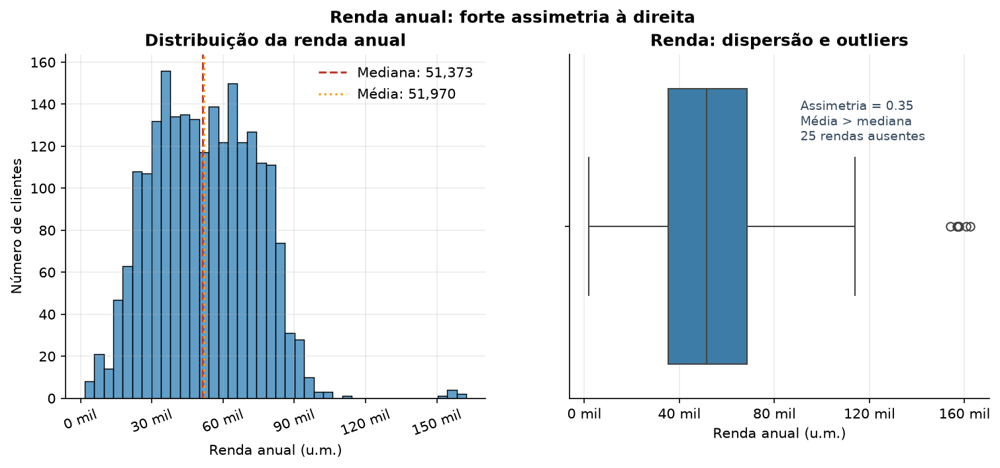

A idade (Figura 2) é praticamente simétrica (assimetria 0,09), com mediana de 44 anos e a maior parte dos clientes entre 36 e 54 anos. Há poucos clientes acima de 70 anos, mantidos por serem plausíveis.

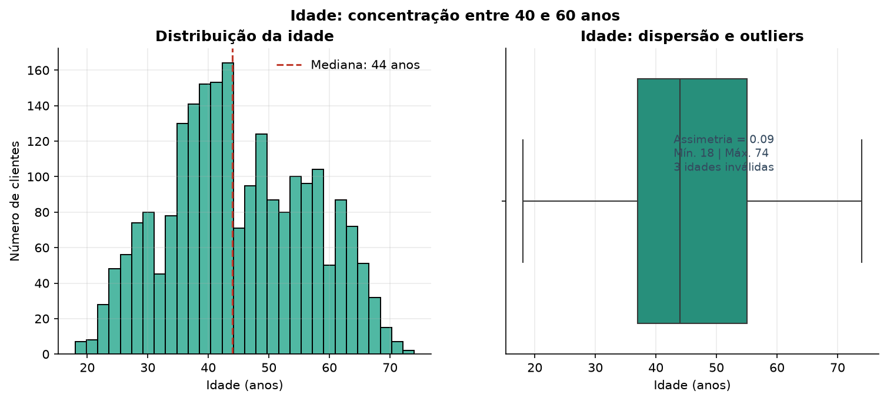

O gasto total (Figura 3) apresenta distribuição **bimodal**: um contingente numeroso com gasto próximo de zero e um grupo com gasto elevado, separados por uma região de baixa densidade. Essa forma não é um artefato: reflete dois comportamentos de consumo distintos na base e é o que torna a segmentação por percentil informativa. A mediana é de 396,00 u.m. e a média de 605,80 u.m.

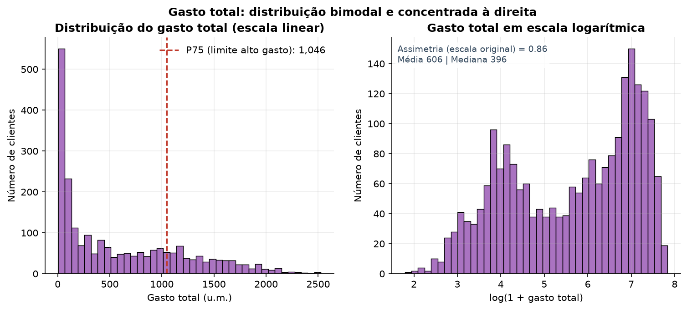

A Tabela 3 resume as variáveis centrais.

**Tabela 3 — Estatísticas descritivas (após tratamento)**

| Variável | Mediana | Média | Desvio-padrão | Mín. | Máx. | Assimetria |
|---|---:|---:|---:|---:|---:|---:|
| Renda anual | 51.373,00 | 51.969,86 | 21.526,32 | 1.730 | 162.397 | 0,35 |
| Idade (anos) | 44 | 45,10 | 11,70 | 18 | 74 | 0,09 |
| Gasto total | 396,00 | 605,80 | 602,25 | 5 | 2.525 | 0,86 |
| Total de compras | 12 | 12,54 | 7,21 | 0 | 32 | 0,30 |
| Compras com desconto | 2 | 2,33 | 1,93 | 0 | 15 | 2,42 |
| Tempo de relacionamento (meses) | 11,68 | 11,62 | 6,64 | 0,00 | 22,97 | −0,02 |

Na composição da base, predominam clientes com graduação (50,3%), casados ou em união estável (64,5%) e com um filho no domicílio (50,4%). A loja física é o canal com mais compras (mediana de 5), seguida de web (4) e catálogo (2). A recência mediana é de 49 dias desde a última compra.

---

## 8. Definição e dimensionamento dos clientes de alto gasto

Aplicando o percentil 75 do gasto total (1.045,50 u.m.), obtêm-se 560 clientes de alto gasto (25,00%) e 1.680 demais clientes (75,00%). Não há empates no valor de corte.

**Tabela 4 — Segmentação por gasto**

| Grupo | N | % clientes | Gasto acumulado (u.m.) | % do gasto total | Média | Mediana | Mediana gasto mensal |
|---|---:|---:|---:|---:|---:|---:|---:|
| Alto gasto | 560 | 25,00 | 834.666 | **61,51** | 1.490,48 | 1.440,00 | 108,18 |
| Demais clientes | 1.680 | 75,00 | 522.322 | 38,49 | 310,91 | 160,50 | 19,59 |
| **Total** | **2.240** | **100,00** | **1.356.988** | **100,00** | 605,80 | 396,00 | 37,50 |

**Resposta a P7:** um quarto dos clientes responde por **61,51%** do gasto total. O gasto médio do grupo é 4,79× o dos demais e a mediana é 8,97× — o múltiplo maior na mediana mostra que o grupo de alto gasto é internamente mais homogêneo, enquanto a cauda inferior dos demais puxa sua média para baixo.

A concentração é ainda mais acentuada dentro do grupo (Figura 4): os 10% maiores gastadores respondem por 30,16% do gasto, os 20% maiores por 52,33% e os 50% maiores por 90,78%.

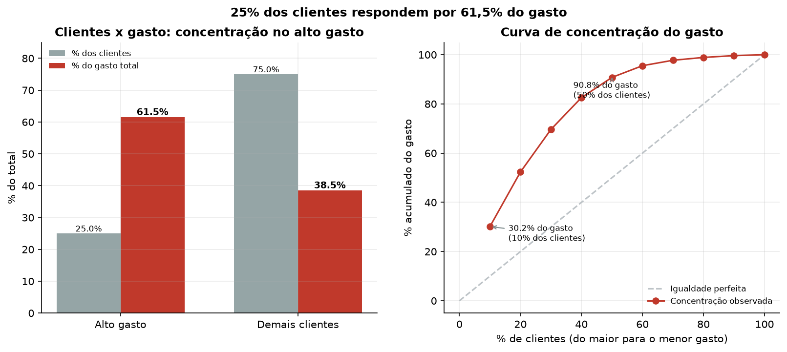

**Tabela 5 — Concentração do gasto por decis de clientes (ordenados do maior para o menor gasto)**

| % de clientes | 10 | 20 | 30 | 40 | 50 | 60 | 70 | 80 | 90 | 100 |
|---|---:|---:|---:|---:|---:|---:|---:|---:|---:|---:|
| % acumulado do gasto | 30,16 | 52,33 | 69,64 | 82,57 | 90,78 | 95,53 | 97,74 | 98,89 | 99,63 | 100,00 |

---

## 9. Resultados das análises comparativas

### 9.1 Perfil financeiro, demográfico e temporal

**Tabela 6 — Comparação entre os segmentos**

| Variável | Média (alto) | Mediana (alto) | Média (demais) | Mediana (demais) | Razão de medianas |
|---|---:|---:|---:|---:|---:|
| Renda anual | 75.238,19 | 75.295,50 | 44.171,68 | 42.691,00 | 1,76 |
| Idade (anos) | 45,99 | 45,00 | 44,80 | 43,00 | 1,05 |
| Número de filhos | 0,38 | 0,00 | 1,14 | 1,00 | — |
| Tempo de relacionamento (meses) | 13,05 | 13,85 | 11,14 | 10,94 | 1,27 |
| Gasto mensal (u.m./mês) | 355,12 | 108,19 | 116,03 | 19,59 | 5,52 |
| Total de compras | 19,99 | 20,00 | 10,05 | 7,00 | 2,86 |
| Compras com desconto | 1,86 | 1,00 | 2,48 | 2,00 | 0,50 |
| Visitas ao site por mês | 3,62 | 3,00 | 5,88 | 6,00 | 0,50 |

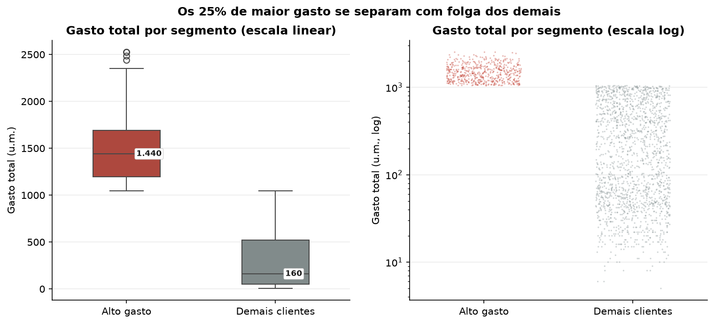

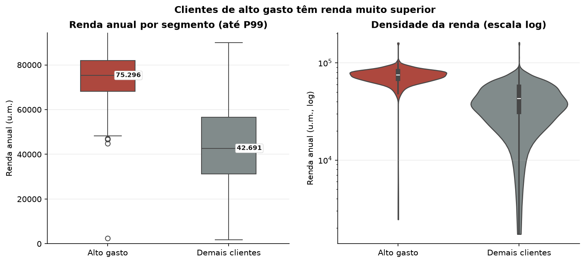

**Perfil financeiro (Figura 6).** A renda é a diferença mais nítida: a mediana do grupo de alto gasto (75.295,50 u.m.) é 1,76× a dos demais (42.691,00 u.m.). As distribuições se sobrepõem apenas nas faixas altas, e o cliente típico de alto gasto situa-se acima de 70 mil u.m. de renda anual.

**Perfil demográfico (Figuras 7 e 8).** A idade praticamente não separa os grupos: medianas de 45 e 43 anos, diferença de apenas 1,19 ano nas médias. O número de filhos é um divisor forte — média de 0,38 contra 1,14. Entre os clientes de alto gasto, 66,8% não têm filhos, contra 15,7% entre os demais. A escolaridade apresenta diferença pequena mas consistente: doutorado é a categoria com maior taxa de alto gasto (29,2%), e nenhum cliente com escolaridade básica (n = 54) está no quartil superior. O estado civil **não** separa os grupos de forma relevante (taxas de alto gasto entre 23,3% e 35,1%, com o teste de independência não significativo — Seção 10).

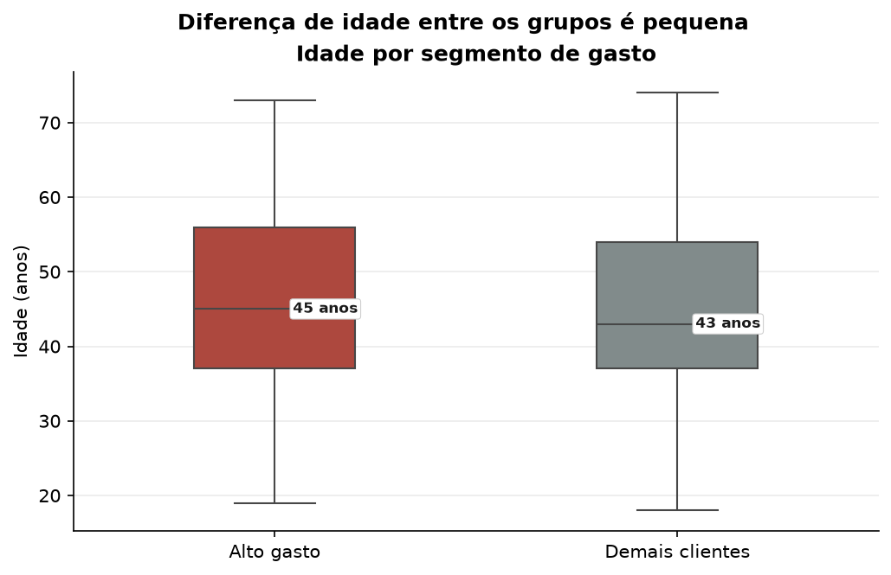

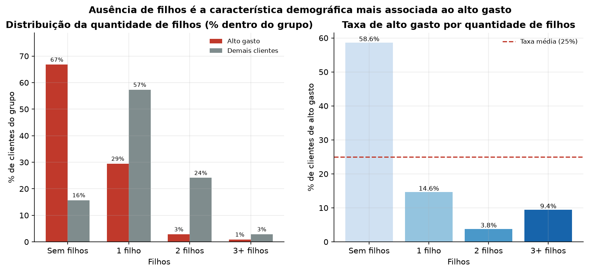

**Perfil temporal.** O tempo de relacionamento mediano é de 13,85 meses no alto gasto contra 10,94 meses nos demais. A diferença é pequena em magnitude, mas relevante para a interpretação: o grupo de alto gasto é ligeiramente **mais antigo**, o que reforça, e não explica, seu gasto acumulado. Normalizando pelo tempo, a mediana do gasto mensal é de 108,19 u.m./mês no alto gasto contra 19,59 u.m./mês nos demais (5,52×), conforme detalhado na Seção 9.4.

### 9.2 Canais de compra

**Pergunta P2.** A base registra a **quantidade** de compras por canal, não o valor gasto em cada canal. As conclusões, portanto, referem-se a frequência de compras.

**Tabela 7 — Compras por canal e por segmento**

| Canal | Grupo | Total de compras | Média por cliente | Mediana | % das compras do grupo | % de clientes com compra |
|---|---|---:|---:|---:|---:|---:|
| Web | Alto gasto | 3.139 | 5,61 | 5,00 | 28,04 | 99,11 |
| Web | Demais | 6.011 | 3,58 | 3,00 | 35,60 | 97,38 |
| Catálogo | Alto gasto | 3.309 | 5,91 | 6,00 | 29,56 | 99,82 |
| Catálogo | Demais | 2.654 | 1,58 | 1,00 | 15,72 | 65,18 |
| Loja física | Alto gasto | 4.748 | 8,48 | 9,00 | 42,41 | 99,46 |
| Loja física | Demais | 8.222 | 4,89 | 4,00 | 48,69 | 99,29 |

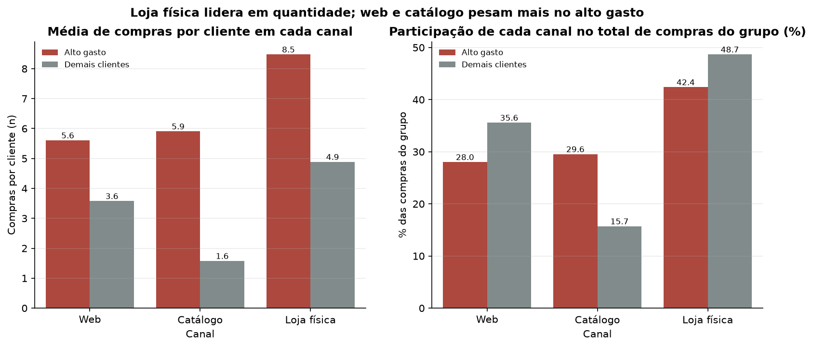

A loja física é o canal mais usado pelos dois grupos em volume, com média de 8,48 compras por cliente no alto gasto contra 4,89 nos demais. O que muda é a **intensidade relativa** dos outros canais: o catálogo salta de 1,58 para 5,91 compras por cliente (3,74×), e a web de 3,58 para 5,61. Como canal predominante de cada cliente (aquele em que ele mais compra), a loja física lidera (61,1% do grupo de alto gasto), mas o catálogo é predominante para 19,6% do alto gasto contra 3,0% dos demais — o maior contraste relativo entre os grupos.

**Limitação:** não existe valor monetário por canal na base. É incorreto afirmar que a loja física "gera mais faturamento" no segmento; ela gera mais **transações**. A distribuição do gasto entre canais é desconhecida.

### 9.3 Compras com desconto

**Pergunta P3.** `NumDealsPurchases` conta compras realizadas com ofertas/descontos. O atributo **não comprova uso de cupom** — a base não identifica o mecanismo promocional.

**Tabela 8 — Compras com desconto por segmento**

| Grupo | Média | Mediana | Clientes que usaram (%) | Média entre usuários |
|---|---:|---:|---:|---:|
| Alto gasto | 1,86 | 1,00 | 94,64 | 1,96 |
| Demais clientes | 2,48 | 2,00 | 99,05 | 2,50 |

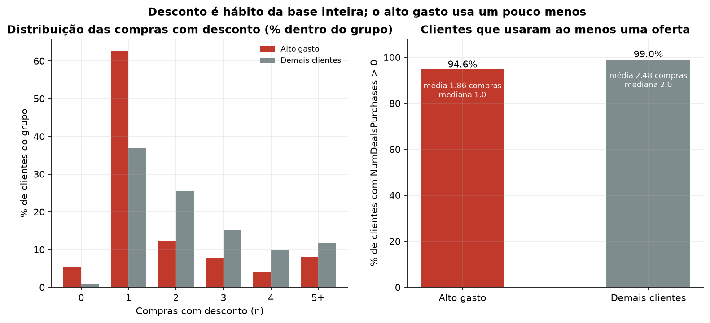

O uso de ofertas é quase universal, mas a **intensidade** é menor no alto gasto: 94,6% já usaram alguma oferta (contra 99,1%) e a média é de 1,86 compras com desconto contra 2,48. A distribuição confirma: 5,4% do alto gasto nunca usou oferta, contra 1,0% dos demais, e a moda do alto gasto é uma compra com desconto, contra duas nos demais. Desconto não é o motor do segmento de alto valor — e, como se trata de associação descritiva, não é possível afirmar que reduzir descontos aumentaria o gasto.

### 9.4 Categorias de produto

**Pergunta P4.**

**Tabela 9 — Gasto por categoria de produto**

| Categoria | Gasto total (u.m.) | % do gasto global | Média (alto) | Mediana (alto) | Média (demais) | Mediana (demais) | % na cesta (alto) | % na cesta (demais) | Razão de médias |
|---|---:|---:|---:|---:|---:|---:|---:|---:|---:|
| Vinhos | 680.816 | 50,17 | 739,27 | 736,50 | 158,82 | 68,00 | 49,60 | 51,08 | 4,65 |
| Carnes | 373.968 | 27,56 | 456,79 | 420,00 | 70,34 | 30,00 | 30,65 | 22,62 | 6,49 |
| Ouro | 98.609 | 7,27 | 78,93 | 56,50 | 32,39 | 17,00 | 5,30 | 10,42 | 2,44 |
| Peixes | 84.057 | 6,19 | 89,47 | 76,00 | 20,21 | 7,00 | 6,00 | 6,50 | 4,43 |
| Doces | 60.621 | 4,47 | 63,89 | 50,00 | 14,79 | 5,00 | 4,29 | 4,76 | 4,32 |
| Frutas | 58.917 | 4,34 | 62,11 | 50,00 | 14,37 | 4,00 | 4,17 | 4,62 | 4,32 |

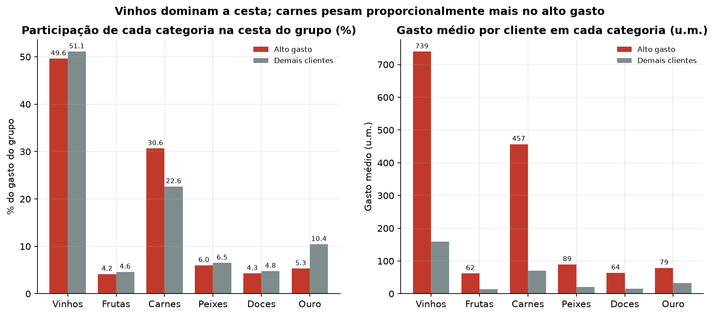

Vinhos concentram 50,17% de todo o gasto da base (680.816 u.m.), seguidos de carnes (27,56%). Na cesta do alto gasto, vinhos (49,60%) e carnes (30,65%) somam 80,25%. A comparação das composições revela duas diferenças: **carnes** pesam proporcionalmente mais no alto gasto (30,65% contra 22,62%), enquanto **ouro** pesa proporcionalmente mais entre os demais (10,42% contra 5,30%) — ouro funciona mais como compra ocasional de ticket baixo do que como pilar do alto gasto.

Todas as categorias crescem no grupo de alto gasto, mas em graus distintos: carnes 6,49×, vinhos 4,65×, peixes 4,43×, frutas e doces 4,32× e ouro apenas 2,44×. O grupo de alto gasto é responsável por 68,40% de toda a venda de carnes e 60,81% da de vinhos.

### 9.5 Robustez temporal

**Pergunta P9.** O gasto é acumulado desde o cadastro, de modo que clientes mais antigos tiveram mais tempo para gastar. Para verificar se isso distorce a leitura, comparou-se a segmentação principal com uma segmentação alternativa pelo **gasto mensal** (mesmo critério de percentil 75).

**Tabela 10 — Concordância entre a segmentação por gasto acumulado e por gasto mensal**

| | Alto gasto (mensal) | Demais (mensal) |
|---|---:|---:|
| **Alto gasto (acumulado)** | 353 | 207 |
| **Demais (acumulado)** | 208 | 1.470 |

| Indicador | Valor |
|---|---:|
| Acordo observado | 81,46% |
| Kappa de Cohen | 0,51 (concordância moderada) |

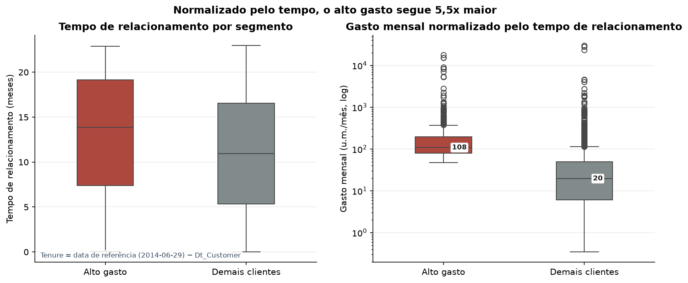

O tempo de relacionamento é ligeiramente maior no alto gasto (13,85 vs 10,94 meses), mas a distância é pequena. Normalizando, a mediana do gasto mensal do alto gasto (108,19 u.m./mês) continua 5,52× a dos demais (19,59 u.m./mês). A segmentação pelo gasto mensal concorda com a segmentação pelo gasto acumulado em 81,46% dos casos: dos 560 clientes de alto gasto acumulado, 353 permanecem no quartil superior quando se usa o gasto mensal.

A conclusão é que **o tempo de relacionamento não inverte a leitura**: ele explica parte da variabilidade (ρ = 0,18), mas não é o mecanismo por trás da concentração de gasto. A segmentação principal foi mantida com base no gasto acumulado, conforme definido no escopo, e o gasto mensal foi usado como verificação.

### 9.6 Relação entre renda e gasto

**Pergunta P8.** A associação entre renda e gasto total é forte e positiva: ρ de Spearman = 0,852 (n = 2.215; p < 0,001).

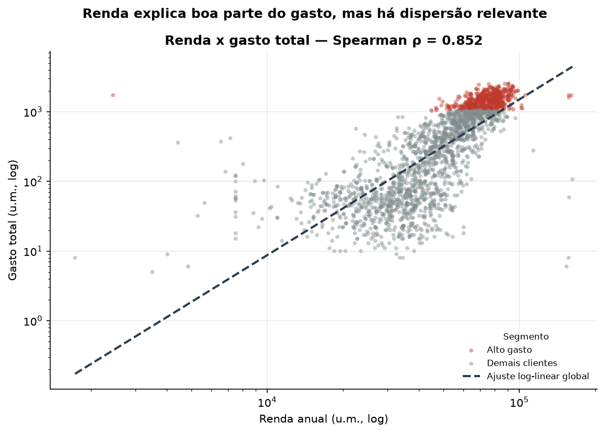

Em um modelo log-log, a elasticidade estimada é de 2,24 (IC95%: 2,15–2,32; R² = 0,575). Incluindo idade e número de filhos, a elasticidade cai para 2,01 e o R² sobe para 0,643; cada filho adicional associa-se a cerca de 54% menos gasto, mantendo a renda constante (Tabela 11).

**Tabela 11 — Regressão log-log do gasto total**

| Modelo | Termo | Coeficiente | IC95% | p | R² | n |
|---|---|---:|---|---:|---:|---:|
| M1 | log(renda) | 2,2352 | 2,1550 – 2,3154 | < 0,001 | 0,575 | 2.212 |
| M2 | log(renda) | 2,0133 | 1,9347 – 2,0919 | < 0,001 | 0,643 | 2.212 |
| M2 | Idade | 0,0051 | 0,0018 – 0,0084 | 0,0025 | 0,643 | 2.212 |
| M2 | Total de filhos | −0,5397 | −0,5912 – −0,4883 | < 0,001 | 0,643 | 2.212 |

A elasticidade acima de 1 **não** deve ser lida como relação causal nem como proporção exata: como o gasto tem piso próximo de zero enquanto a renda não, a curva log-log é convexa e a elasticidade superestima o efeito em comparações extremas. O modelo serve para quantificar a dominância da renda (R² entre 0,575 e 0,643), não para previsão.

---

## 10. Análise estatística

### 10.1 Verificação de premissas

A normalidade é rejeitada (Shapiro-Wilk, p < 0,001) em ambos os grupos para todas as variáveis analisadas, e as variâncias são desiguais para a maioria delas (Levene, p < 0,05). A assimetria é particularmente severa em `GastoMensal` (9,27 no alto gasto e 22,47 nos demais). Com n grande, o Teorema Central do Limite ampararia a comparação de médias, mas a assimetria forte torna a mediana o resumo mais fiel — o que justifica o uso de testes não paramétricos.

**Tabela 12 — Testes estatísticos (α = 0,05; p ajustado por Benjamini-Hochberg)**

| Pergunta | Teste | Estatística | p | Tamanho de efeito | p ajustado |
|---|---|---:|---:|---|---:|
| A renda difere entre os grupos? | Mann-Whitney | 859.332,50 | < 0,001 | r = 0,86 (grande) | < 0,001 |
| O número de filhos difere? | Mann-Whitney | 203.527,50 | < 0,001 | r = −0,57 (grande) | < 0,001 |
| O gasto mensal difere? | Mann-Whitney | 841.074,50 | < 0,001 | r = 0,79 (grande) | < 0,001 |
| A intensidade de visitas ao site difere? | Mann-Whitney | 224.445,00 | < 0,001 | r = −0,52 (grande) | < 0,001 |
| O uso de descontos difere? | Mann-Whitney | 327.502,50 | < 0,001 | r = −0,30 (médio) | < 0,001 |
| O tempo de relacionamento difere? | Mann-Whitney | 548.092,50 | < 0,001 | r = 0,17 (pequeno) | < 0,001 |
| A idade difere? | Mann-Whitney | 497.585,50 | 0,031 | r = 0,06 (desprezível) | 0,033 |
| A faixa de renda é independente do segmento? | Qui-quadrado (gl=4) | 1.115,50 | < 0,001 | V = 0,71 (grande) | < 0,001 |
| Ter filhos é independente do segmento? | Qui-quadrado (gl=1) | 535,29 | < 0,001 | V = 0,49 (médio) | < 0,001 |
| O canal predominante é independente? | Qui-quadrado (gl=3) | 183,10 | < 0,001 | V = 0,29 (pequeno) | < 0,001 |
| A escolaridade é independente do segmento? | Qui-quadrado (gl=4) | 26,52 | < 0,001 | V = 0,11 (pequeno) | < 0,001 |
| A faixa etária é independente do segmento? | Qui-quadrado (gl=4) | 18,79 | < 0,001 | V = 0,09 (desprezível) | 0,001 |
| O estado civil é independente do segmento? | Qui-quadrado (gl=5) | 7,60 | 0,179 | V = 0,06 (desprezível) | 0,179 |

Doze dos treze testes permanecem significativos após a correção. Três resultados exigem ressalva, porque significância estatística não equivale a relevância prática:

- **Idade:** p = 0,033, mas r = 0,06 (desprezível). Com 2.240 clientes, uma diferença de 1,2 ano aparece como significativa. A conclusão prática é que idade **não** distingue os grupos.
- **Faixa etária:** V de Cramér = 0,09 (desprezível), coerente com o item anterior.
- **Estado civil:** p = 0,179, sem evidência de associação (V = 0,06).

### 10.2 Correlações

**Tabela 13 — Correlações de Spearman com o gasto total (n = 2.240; p ajustado por BH)**

| Variável | ρ | Magnitude | p ajustado |
|---|---:|---|---:|
| Total de compras | 0,908 | grande | < 0,001 |
| Compras por catálogo | 0,892 | grande | < 0,001 |
| Renda anual | 0,852 | grande | < 0,001 |
| Número de filhos | −0,484 | médio | < 0,001 |
| Visitas ao site por mês | −0,476 | médio | < 0,001 |
| Tempo de relacionamento | 0,184 | pequeno | < 0,001 |
| Idade | 0,158 | pequeno | < 0,001 |
| Compras com desconto | −0,015 | desprezível | 0,483 |

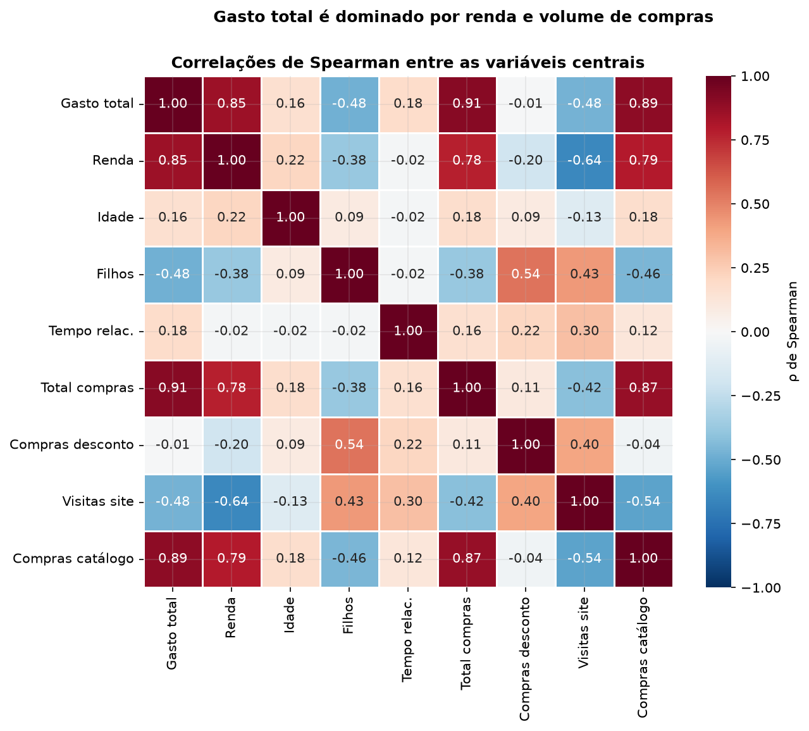

Gastar mais é, quase por definição, comprar mais (ρ = 0,908). O achado informativo está na hierarquia dos canais e do comportamento digital: a correlação com compras por catálogo (0,892) é superior à da renda (0,852), e a correlação com visitas ao site é **negativa** (−0,476) — quem mais navega no site é quem menos compra, padrão típico de navegação sem conversão. Compras com desconto não têm associação com o gasto acumulado (ρ = −0,015; p ajustado = 0,483).

---

## 11. Análise do público-alvo

**Perguntas P5 e P6.** Para identificar o público que concentra o gasto, distinguem-se duas medidas que costumam ser confundidas:

- **taxa de alto gasto** (probabilidade condicional): P(alto gasto | perfil);
- **participação nos altos**: parcela do grupo de alto gasto que possui aquele perfil.

Um perfil pode ter taxa elevada e participação pequena (grupo raro) ou o contrário. A Tabela 14 apresenta ambas, com intervalo de confiança de Wilson e `lift` (taxa do perfil ÷ 25%).

**Tabela 14 — Perfis associados ao alto gasto**

| Dimensão | Categoria | n | Alto gasto (n) | Taxa (%) | IC95% | % dos altos | Lift |
|---|---|---:|---:|---:|---|---:|---:|
| Renda | Q5 (maior) | 443 | 352 | 79,46 | 75,45 – 82,96 | 62,86 | 3,18 |
| Renda | Q4 | 443 | 173 | 39,05 | 34,62 – 43,67 | 30,89 | 1,56 |
| Renda | Q3 | 443 | 30 | 6,77 | 4,78 – 9,50 | 5,36 | 0,27 |
| Renda | Q2 | 443 | 0 | 0,00 | 0,00 – 0,86 | 0,00 | 0,00 |
| Renda | Q1 (menor) | 443 | 1 | 0,23 | 0,04 – 1,27 | 0,18 | 0,01 |
| Filhos | Sem filhos | 638 | 374 | 58,62 | 54,76 – 62,38 | 66,79 | 2,34 |
| Filhos | 1 filho | 1.128 | 165 | 14,63 | 12,69 – 16,81 | 29,46 | 0,59 |
| Filhos | 2 filhos | 421 | 16 | 3,80 | 2,35 – 6,08 | 2,86 | 0,15 |
| Filhos | 3+ filhos | 53 | 5 | 9,43 | 4,10 – 20,25 | 0,89 | 0,38 |
| Escolaridade | Doutorado | 486 | 142 | 29,22 | 25,35 – 33,41 | 25,36 | 1,17 |
| Escolaridade | Graduação | 1.127 | 293 | 26,00 | 23,52 – 28,64 | 52,32 | 1,04 |
| Escolaridade | Mestrado | 370 | 83 | 22,43 | 18,48 – 26,95 | 14,82 | 0,90 |
| Escolaridade | Ciclo 2 | 203 | 42 | 20,69 | 15,69 – 26,78 | 7,50 | 0,83 |
| Escolaridade | Básico | 54 | 0 | 0,00 | 0,00 – 6,64 | 0,00 | 0,00 |
| Estado civil | Viúvo(a) | 77 | 27 | 35,06 | 25,35 – 46,20 | 4,82 | 1,40 |
| Estado civil | Solteiro(a) | 483 | 127 | 26,29 | 22,57 – 30,40 | 22,68 | 1,05 |
| Estado civil | Divorciado(a) | 232 | 61 | 26,29 | 21,05 – 32,31 | 10,89 | 1,05 |
| Estado civil | União estável | 580 | 142 | 24,48 | 21,16 – 28,14 | 25,36 | 0,98 |
| Estado civil | Casado(a) | 864 | 201 | 23,26 | 20,57 – 26,20 | 35,89 | 0,93 |
| Idade | 60+ | 316 | 99 | 31,33 | 26,47 – 36,64 | 17,68 | 1,25 |
| Idade | 18-29 | 221 | 66 | 29,86 | 24,22 – 36,20 | 11,79 | 1,19 |
| Idade | 50-59 | 467 | 128 | 27,41 | 23,56 – 31,63 | 22,86 | 1,10 |
| Idade | 40-49 | 676 | 148 | 21,89 | 18,94 – 25,16 | 26,43 | 0,88 |
| Idade | 30-39 | 557 | 118 | 21,18 | 17,99 – 24,77 | 21,07 | 0,85 |

**Renda é o eixo dominante.** Na faixa Q5, 79,46% dos clientes são de alto gasto (IC95%: 75,45–82,96) e essa faixa concentra 62,86% de todos os clientes de alto gasto. Em Q1 e Q2 a taxa é praticamente zero. A renda funciona, portanto, como **condição quase necessária — mas não suficiente** — para o alto gasto: 20,5% dos clientes de Q5 não estão no quartil superior de gasto.

**Filhos são o segundo filtro mais forte.** Clientes sem filhos têm taxa de 58,62% (374 de 638; lift 2,34) e representam 66,79% do grupo de alto gasto. Com um filho a taxa cai para 14,63%; com dois, para 3,80%.

**Escolaridade** contribui de forma secundária: doutorado tem a maior taxa (29,22%) e escolaridade básica, nenhuma ocorrência (0 de 54).

**Idade e estado civil não ordenam o gasto.** As taxas por faixa etária ficam entre 21,18% e 31,33%, sem tendência monotônica, e todas as categorias de estado civil ficam próximas da taxa base. O resultado de "Viúvo(a)" (35,06%) deve ser lido com cautela: são 77 clientes, com intervalo de confiança de 25,35% a 46,20%. A categoria residual "Outros" (n = 4) não sustenta nenhuma conclusão.

### 11.1 Combinações de características

**Tabela 15 — Combinações de renda, filhos e escolaridade (n ≥ 30)**

| Perfil | n | Alto gasto | Taxa (%) | % dos altos | Lift |
|---|---:|---:|---:|---:|---:|
| Q5 · sem filhos · ensino superior | 326 | 272 | 83,44 | 48,92 | 3,32 |
| Q5 · 1 filho · ensino superior | 96 | 68 | 70,83 | 12,23 | 2,82 |
| Q4 · sem filhos · ensino superior | 135 | 88 | 65,19 | 15,83 | 2,60 |
| Q4 · 1 filho · ensino superior | 254 | 77 | 30,31 | 13,85 | 1,21 |
| Q3 · sem filhos · ensino superior | 45 | 11 | 24,44 | 1,98 | 0,97 |
| Q4 · 2 filhos · ensino superior | 48 | 7 | 14,58 | 1,26 | 0,58 |
| Q3 · 1 filho · ensino superior | 253 | 19 | 7,51 | 3,42 | 0,30 |

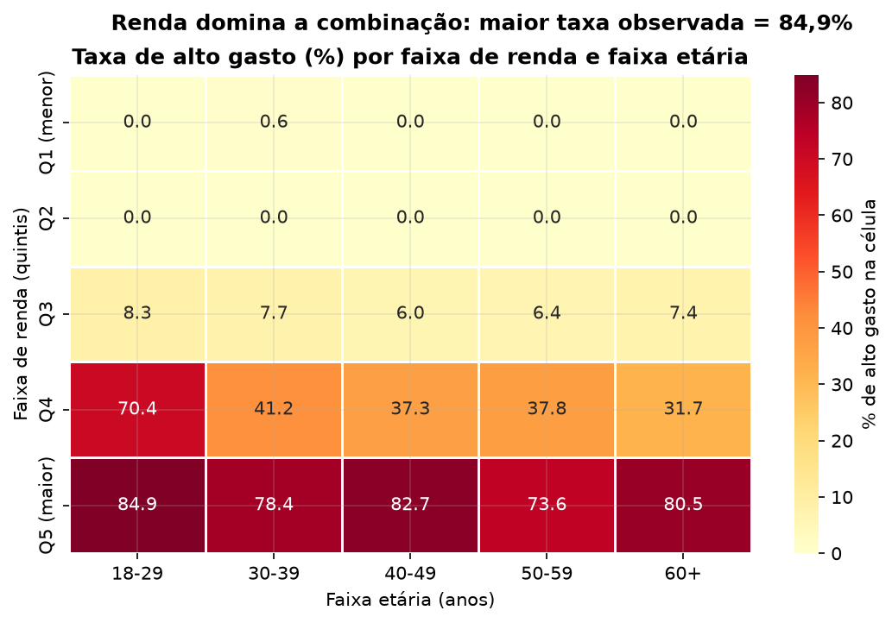

A combinação mais forte é **alta renda · sem filhos · ensino superior**: 83,44% dos seus 326 clientes estão no quartil superior, e o grupo corresponde a 48,92% de todo o grupo de alto gasto. O cruzamento completo renda × filhos confirma o padrão: a taxa cresce de Q1 para Q5 e cai a cada filho adicional, e nenhuma célula de Q1 ou Q2 atinge 1%. O mapa de renda × idade (Figura 15) mostra que a variação relevante é horizontal (entre quintis de renda), não vertical (entre faixas etárias): dentro de Q5, todas as faixas etárias apresentam taxas altas.

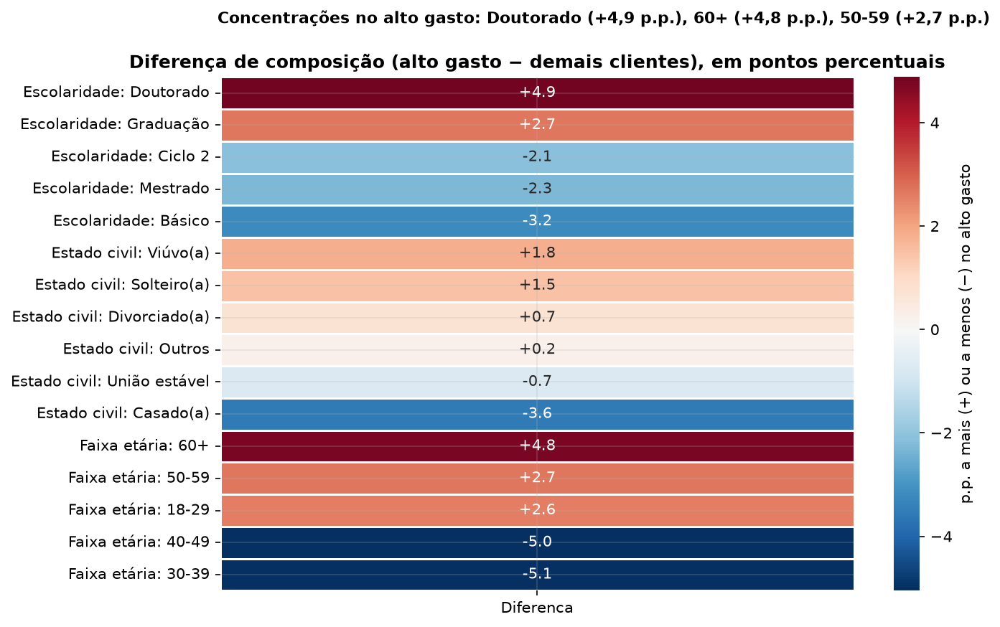

---

## 12. Discussão dos resultados

Os resultados convergem para uma caracterização simples e consistente: **o gasto é concentrado e a renda é o seu principal correlato**, mas renda sozinha não explica tudo. Três padrões merecem discussão.

**Primeiro, a concentração é o fato mais robusto do trabalho.** Um quarto dos clientes responde por 61,51% do gasto, e os 10% maiores por 30,16%. Como o gasto total é a única proxy de faturamento disponível, a implicação gerencial é que qualquer ação de retenção voltada ao quartil superior tem potencial de impacto desproporcional — embora a base não permita quantificar esse impacto em receita líquida.

**Segundo, o perfil do alto gasto é de capacidade de consumo, não de estágio de vida.** A idade não diferencia os grupos (r = 0,06; p ajustado = 0,033, com efeito desprezível) e o estado civil não se associa ao segmento (p = 0,179). O que separa é renda, ausência de filhos e escolaridade superior. Esse resultado contraria a intuição comum de que o consumo elevado se concentra em faixas etárias específicas e reforça que a segmentação por renda e composição familiar é mais informativa que a segmentação etária.

**Terceiro, o comportamento do segmento é de compra planejada e de maior valor unitário, não de caça a descontos.** O grupo usa menos ofertas (1,86 vs 2,48 compras com desconto), visita menos o site (3,62 vs 5,88 visitas/mês) e compra proporcionalmente mais por catálogo — canal tipicamente associado a compra deliberada e a sortimento premium. Vinhos e carnes dominam sua cesta, enquanto ouro pesa proporcionalmente mais entre os demais clientes. A correlação negativa entre visitas ao site e gasto (−0,476) sugere que parte do tráfego digital é de navegação sem conversão, concentrada no segmento de menor gasto.

**Sobre a relação renda–gasto.** A correlação de 0,852 e o R² de 0,575–0,643 indicam que a renda explica a maior parte da variação do gasto, mas não toda. Parte da variância restante está associada à composição familiar (cada filho adicional associa-se a ~54% menos gasto, mantendo a renda constante) e ao canal utilizado. A leitura correta é de **associação**, não de causalidade: aumentar a renda de um cliente não produz, por si, aumento proporcional de gasto — e a convexidade da relação log-log indica que a elasticidade estimada não deve ser extrapolada para comparações extremas.

**Sobre o tempo de relacionamento.** A hipótese de que clientes mais antigos pareçam gastar mais apenas por acumularem mais tempo não se confirmou como explicação principal: a diferença de tempo entre os grupos é pequena (13,85 vs 10,94 meses), o gasto mensal normalizado continua 5,52× maior no alto gasto e as duas segmentações concordam em 81,46% dos casos. O tempo tem papel secundário, não estrutural.

---

## 13. Limitações

1. **Gasto como proxy de faturamento.** A base não contém lucro, margem nem custo promocional. `GastoTotal` é a melhor aproximação disponível do valor gerado pelo cliente, não receita líquida — e não há como avaliar rentabilidade dos segmentos.
2. **Estudo descritivo e transversal.** Todas as relações são associações observadas em um único retrato temporal. Nenhuma conclusão causal é possível; "clientes sem filhos gastam mais" não implica que ter filhos reduza o gasto.
3. **`NumDealsPurchases` não comprova cupom.** O atributo registra compras com ofertas/descontos, sem identificar o mecanismo promocional utilizado.
4. **Gasto acumulado depende do tempo de relacionamento.** Tratado por normalização mensal e pela análise de concordância da Seção 9.5, mas não eliminado.
5. **Data de referência é uma proxy (29-06-2014).** O nível do gasto mensal é sensível a essa escolha; a comparação entre grupos não é, pois o viés atinge ambos os grupos.
6. **A amostra descreve a base, não a população de consumidores.** Não há informação sobre clientes que deixaram a empresa, e nada garante que os 2.240 clientes sejam representativos de todos os consumidores.
7. **Ausências não imputadas.** Vinte e cinco clientes sem renda utilizável ficam fora das análises de renda e de parte das combinações de perfil (1,1% da base, sem impacto material nas conclusões, mas alterando o n exato de cada tabela).
8. **Sem valor monetário por canal.** A análise de canais mede frequência de compras, não faturamento; conclusões sobre "canal mais rentável" estão fora do alcance da base.
9. **Categorizações são escolhas analíticas.** Quintis de renda e décadas de idade poderiam ser substituídos por outros cortes; a direção dos resultados é robusta, mas os valores exatos das tabelas de público-alvo mudariam.
10. **Segmentação por percentil é relativa à amostra.** O limite de 1.045,50 u.m. descreve esta base; em outra amostra, o valor de corte seria diferente.

---

## 14. Conclusão

O trabalho identificou e caracterizou os clientes de maior gasto da base *Customer Personality Analysis*, respondendo às nove perguntas de pesquisa com evidências calculadas e verificadas.

**Quem são os clientes que mais gastam.** São os 25% com `GastoTotal` a partir de 1.045,50 u.m. O cliente típico desse grupo tem renda anual mediana de 75.295,50 u.m. (1,76× a dos demais), não tem filhos (66,8% do grupo), tem escolaridade superior — com destaque para o doutorado — e idade próxima à mediana da base. Idade e estado civil não são marcadores úteis desse segmento.

**Quanto representam do gasto total.** Os 25% de maior gasto respondem por **61,51%** do gasto total (834.666 de 1.356.988 u.m.), e os 10% maiores por 30,16%. A concentração é o resultado mais robusto do trabalho.

**Qual canal utilizam.** A loja física lidera em volume (8,48 compras por cliente; 42,4% das compras do grupo), mas o catálogo é o canal que mais diferencia o segmento: 5,91 compras por cliente contra 1,58 nos demais (3,74×) e presença como canal predominante em 19,6% do grupo contra 3,0% dos demais. Não há dados de valor monetário por canal.

**Quais categorias concentram seus gastos.** Vinhos (49,60% da cesta) e carnes (30,65%) somam 80,25% do gasto do grupo; carnes crescem 6,49× em relação aos demais clientes, o maior salto entre as seis categorias, e o grupo responde por 68,40% de toda a venda de carnes da base.

**Comportamento em relação a descontos.** O uso de ofertas é quase universal, mas menos intenso no grupo de alto valor: 1,86 compras com desconto contra 2,48 nos demais, com 94,6% de usuários contra 99,1%. Desconto não é o motor desse segmento.

**Características demográficas que se destacam.** Ausência de filhos (taxa de alto gasto de 58,62% contra 3,80% entre quem tem dois filhos) e escolaridade superior (doutorado com 29,22%). Renda é a variável mais associada (ρ = 0,852).

**Público a priorizar.** A combinação **alta renda · sem filhos · ensino superior** concentra 48,92% de todos os clientes de alto gasto, com taxa de 83,44% e lift de 3,32. A faixa Q5 de renda, sozinha, responde por 62,86% dos clientes de alto gasto. Recomenda-se: (i) priorizar esse perfil em ações de sortimento e comunicação; (ii) tratar o catálogo como canal de relacionamento do segmento premium; (iii) concentrar esforços em vinhos e carnes; (iv) não usar desconto como principal alavanca de ativação desse público; (v) não segmentar por idade nem por estado civil, pois os dados não sustentam associação relevante.

**Limitações a considerar.** O gasto é proxy de faturamento (não há lucro nem margem); o estudo é descritivo e transversal, sem inferência causal; `NumDealsPurchases` não comprova uso de cupom; o gasto acumulado depende do tempo de relacionamento, tratado por normalização; a data de referência é uma proxy documentada; e os resultados descrevem esta base, não toda a população de consumidores.

---

## 15. Referências

BENJAMINI, Y.; HOCHBERG, Y. Controlling the false discovery rate: a practical and powerful approach to multiple testing. *Journal of the Royal Statistical Society: Series B*, v. 57, n. 1, p. 289–300, 1995.

COHEN, J. *Statistical Power Analysis for the Behavioral Sciences*. 2. ed. Hillsdale: Lawrence Erlbaum, 1988.

KAGGLE. *Customer Personality Analysis* (dataset `marketing_campaign.csv`). Disponível em: https://www.kaggle.com/datasets/imakash3011/customer-personality-analysis. Acesso em: 2026.

MCKINNEY, W. *Python for Data Analysis*. 3. ed. Sebastopol: O'Reilly Media, 2022.

SEABOLD, S.; PERKTOLD, J. statsmodels: Econometric and statistical modeling with Python. *Proceedings of the 9th Python in Science Conference*, p. 92–96, 2010.

VIRTANEN, P. et al. SciPy 1.0: fundamental algorithms for scientific computing in Python. *Nature Methods*, v. 17, p. 261–272, 2020.

WASKOM, M. seaborn: statistical data visualization. *Journal of Open Source Software*, v. 6, n. 60, p. 3021, 2021.

WILSON, E. B. Probable inference, the law of succession, and statistical inference. *Journal of the American Statistical Association*, v. 22, n. 158, p. 209–212, 1927.
